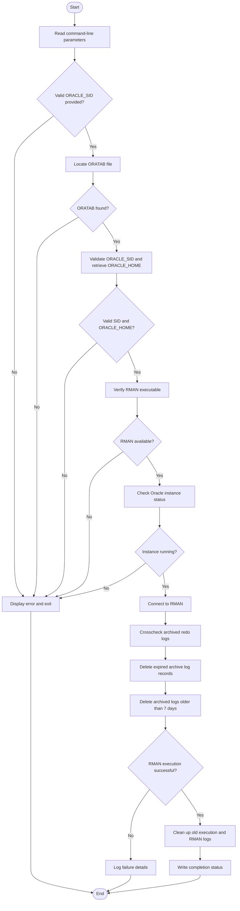

# Oracle Archive Log Management

## Overview

This repository contains Oracle Database archive log management scripts and automation utilities using Recovery Manager (RMAN).

The objective is to simplify archive log maintenance, optimize storage utilization, and support routine Oracle Database administration activities.

## Scripts

| Script | Description |
|---|---|
| `delete_archive.sh` | Automates the deletion of archived redo logs older than the configured retention period using RMAN. |

## Features

- Automated archive log cleanup using RMAN.
- Configurable archive log retention period.
- Oracle SID validation using ORATAB.
- Automatic Oracle Home identification.
- Oracle instance availability verification.
- RMAN crosscheck and expired archive log cleanup.
- Execution logging and error handling.
- Automated log file cleanup.

## Requirements

- Oracle Database
- Oracle Recovery Manager (RMAN)
- Linux/Unix operating system
- KornShell (`ksh`)
- Oracle software owner privileges

## Usage

```bash
./delete_archive.sh -s ORACLE_SID
```

Example:

```bash
./delete_archive.sh -s ORCL
```

## Scheduling

Example cron entry to execute the script daily at 2:00 AM:

```bash
0 2 * * * /home/oracle/scripts/bin/delete_archive.sh -s ORCL
```

## Important Considerations

- Review archive log backup requirements before deletion.
- Consider Data Guard and other downstream dependencies.
- Validate the retention period against recovery requirements.
- Test in a non-production environment before production deployment.

  
## Execution Flow

The following flowchart illustrates the execution process of the archive log cleanup script.




## Disclaimer

These scripts are provided for educational and DBA automation purposes. Review and validate all configurations before using them in production environments.
